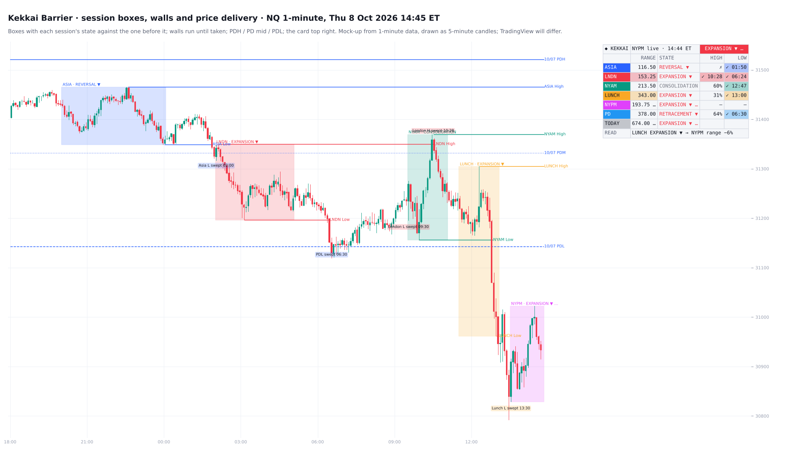
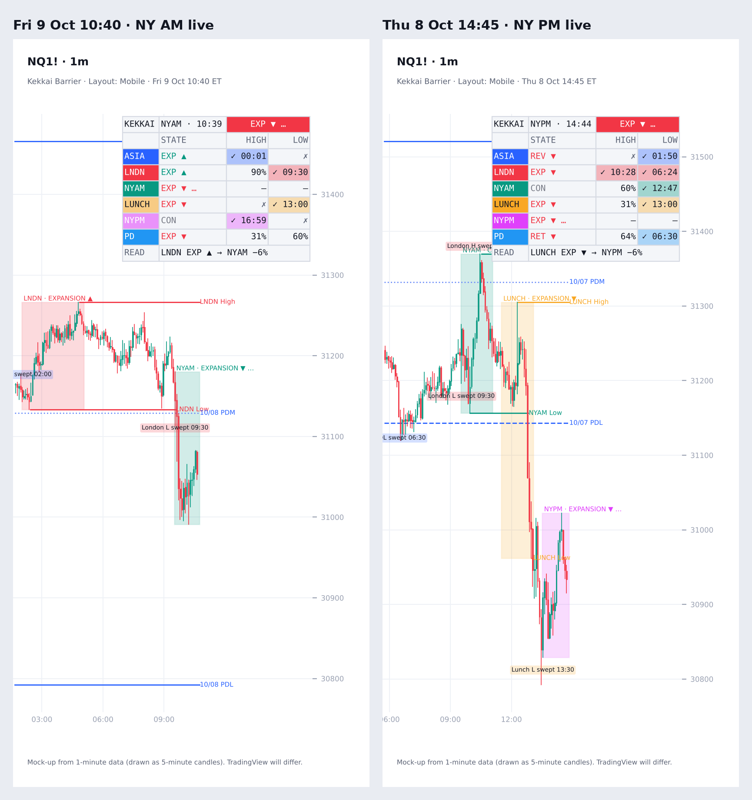

# Kekkai Barrier

**Session boxes, walls and price delivery, with sweeps, shifts and day / week / month levels**

TradingView indicator, Pine Script v6. Open source under the Mozilla Public License 2.0.

*Mock-up of how it looks on the chart, computed from 1-minute data.*

**Kekkai Barrier** boxes each session, says what kind of price delivery it was, and runs its high and low (its walls) until a later session takes them.

## What it draws

**Session boxes.** Each session's high-to-low range, shaded, with its name and state on top. Times are ET and every session is a setting.

| Session | Default time | Role | Read against |
|---|---|---|---|
| ASIA | 20:00–00:00 | builds London's walls | the last NY PM |
| LNDN | 02:00–05:00 | hunts Asia's walls | Asia |
| NYAM | 09:30–11:00 | hunts London's walls | London |
| LUNCH | 11:30–13:00 | builds NY PM's walls | NY AM |
| NYPM | 13:30–16:00 | hunts Lunch's walls | Lunch |

**Price-delivery state.** Each session is read against the session before it:
- **EXPANSION ▲ / ▼:** closed beyond that session's high or low.
- **REVERSAL ▲ / ▼:** took one side of it first, then closed back inside past its midpoint, away from that side.
- **RETRACEMENT ▲ / ▼:** closed inside it, past its midpoint against the way that session moved.
- **CONSOLIDATION:** closed inside it, on the side that session moved to.

While a session is forming, its state is live (marked …).

**Walls:** each session's high and low, labelled (e.g. "ASIA High").
- They run until a later candle trades through them.
- Optionally, they run to the last candle (dashed once taken) or until their hunt session ends.
- Optional midpoints, and a compression flag when a session's range is under 75% of its own 20-session average.

**Day, week and month levels** (exchange day, 18:00 ET start):
- PDH / PD mid / PDL, on by default;
- each day's high / low this week, today's high / low, week and month to date, previous week and month (off by default).

**Sweeps** of the session walls in their hunt session, of PDH / PDL, and optionally of earlier days and the previous week and month.

**Shifts:** two consecutive 30-minute blocks printing HH+HL (bull) or LL+LH (bear) inside London, NY AM or NY PM, marked with the sweep before them.

## The card

| Column | What it shows |
|---|---|
| RANGE | the session's range in points, shaded when at or above its 20-session average |
| STATE | the price-delivery state |
| HIGH / LOW | the odds the next session takes this session's high / low, then ✓ with the time once taken, or ✗ once its hunt session is over |

- **Rows:** one per session (its latest run), then **PD** (the previous day, with PDH / PDL today) and **TODAY** (today so far against the previous day).
- **Header:** the state of the session in play.
- **READ:** what the last closed session's state says about the next session's range.

**Layout: Mobile** (View settings) narrows the card to session, state, high and low for a phone.

## What the tests showed

NQ, ES and RTY 1-minute data 2018–26: 6,124 trading days. Each figure held in 2018–24 and 2025–26 and on each symbol.

- **Where a session closed in its own range sets the odds that the next session takes its high or low.** In the bottom eighth → top eighth of its range:

| Session's high taken by | bottom | top | all |
|---|---|---|---|
| Asia → 05:00 | 25% | 91% | 61% |
| London → 11:00 | 48% | 95% | 75% |
| NY AM → 16:00 | 20% | 94% | 57% |
| Lunch → 16:00 | 31% | 92% | 62% |
| NY PM → 00:00 | 12% | 87% | 47% |
| Previous day → today 16:59 | 14% | 90% | 55% |

  The low mirrors it. The card reads the full eight steps.
- **The state reads the next range.**
  - After a **consolidation** session, the next session's range ran 6–10% larger than after other sessions of the same size.
  - After an **expansion**, it ran 5–9% smaller.
  - This held for all five session pairs.
- **The state does not call direction.** The next session moved the state's way 46–58% of the time. The only steady case is NY AM expansion → NY PM the same way, at 52%.
- **The state adds nothing to the high / low odds** beyond where the session closed. Out-of-sample Brier scores were unchanged, so the card uses the close position alone.
- **How often each state occurs** (EXP / REV / RET / CON):

| Session | EXP | REV | RET | CON |
|---|---|---|---|---|
| Asia | 44% | 4% | 19% | 33% |
| London | 58% | 11% | 10% | 21% |
| NY AM | 72% | 11% | 7% | 10% |
| Lunch | 41% | 5% | 18% | 36% |
| NY PM | 59% | 11% | 10% | 19% |

The earlier Model 4 trade mechanic (shift entries) did not survive a re-test. The indicator draws no entries or targets.

Scripts: `research/` (no market data included).

## Settings

**View** sits at the top:
- layout (Desktop or Mobile);
- theme;
- text size and colour;
- label date format;
- days to keep;
- how older days fade.

Then: card, sessions and boxes, walls, day / week / month, sweeps and shifts.

## Credits

- Concepts: ICT (Michael J. Huddleston): sessions and killzones, and the four states of price delivery (expansion, retracement, reversal, consolidation).
- The session-box look was studied from TradeForOpp's open-source "ICT Killzones & Pivots" (MPL 2.0).
- Written from scratch.

## Add it to TradingView

1. In TradingView, open the **Pine Editor** (bottom panel).
2. Copy the contents of `Kekkai_Barrier_Indicator.pine` into a new script.
3. **Save**, then **Add to chart**.

## License

Mozilla Public License 2.0, see [LICENSE](LICENSE). © Unclehk2000.

*Historical frequencies, not guarantees. Nothing here is financial advice.*
